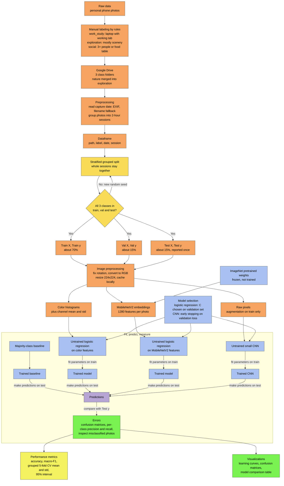

# What is my camera roll made of? Classifying personal photos by activity
 
CS156 Pipeline Assignment 1
 
As a Minerva student my life splits into studying, working, socializing and exploring each rotation city, and sometimes I can't tell which one I'm doing. My phone holds 12,365 photos, so I built a machine learning pipeline that sorts photos into three classes and compared four different approaches.
 
**Final notebook (with all outputs): [`CS156_First_pipeline_clean.ipynb`](CS156_First_pipeline_clean.ipynb)**
Earlier drafts are kept in [`archive/`](archive/).
 
## Classes
 
| class | how I labeled it |
|---|---|
| `work_study` | my laptop screen is visible and shows a tab proving I was working or studying (not a movie) |
| `social` | 3+ people, or a table with more food than one person could eat, or a crowd/event |
| `exploration` | scenery fills at least ~60% of the frame |
 
`social` and `exploration` overlap on purpose (some scenery photos include friends). I wanted to see whether a model could separate them even though I sometimes can't.
 
## Results (test set, 50 photos)
 
| model | test accuracy | test macro-F1 |
|---|---|---|
| Majority-class baseline | 0.76 | 0.288 |
| Color histograms + logistic regression | 0.64 | 0.527 |
| MobileNetV2 features (frozen) + logistic regression | 1.00 | 1.000 |
| Small CNN trained from scratch | 0.80 | 0.494 |
 
**Main findings**
- Accuracy alone is misleading: always guessing `exploration` gets 76% but macro-F1 is only 0.288.
- The CNN never predicted `work_study` (0 of 6 correct on test).
- MobileNetV2 features scored perfectly, but the test set is only 50 photos and I took about 60 work/study photos on a single day, so I checked for leakage and ran grouped cross-validation (see Section 9b of the notebook).
- The CNN's validation curves reflect a split problem, not classic overfitting: the validation set is 86% `work_study` while training has only 32 such photos.
## Pipeline

## Data and privacy
 
The photos are personal and are **not** included in this repository (my Google Drive is private). The notebook's saved outputs show every result, so you can read it without re-running it. To re-run it you would need your own photos in `MyDrive/data/Work`, `Socials` and `Exploration`.
 
## How to run
 
1. Open the notebook in Google Colab.
2. Put your labeled photos on Drive in the three folders above.
3. Runtime → Run all (the first cell mounts Drive and installs `pillow-heif` for `.heic` photos).
Libraries: TensorFlow/Keras, scikit-learn, pandas, NumPy, Pillow, matplotlib.
 
## References
 
- Sandler, M., Howard, A., Zhu, M., Zhmoginov, A., & Chen, L.-C. (2018). MobileNetV2: Inverted residuals and linear bottlenecks. *CVPR*, 4510-4520.
- Pedregosa, F., et al. (2011). Scikit-learn: Machine learning in Python. *JMLR, 12*, 2825-2830.
- TensorFlow tutorials: [Image classification](https://www.tensorflow.org/tutorials/images/classification), [Transfer learning](https://www.tensorflow.org/tutorials/images/transfer_learning)
- Full list in the notebook.
 
